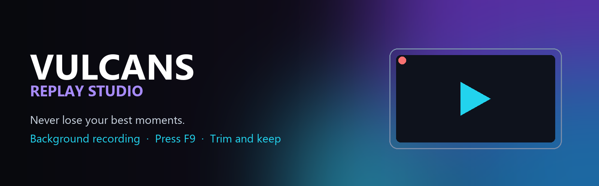
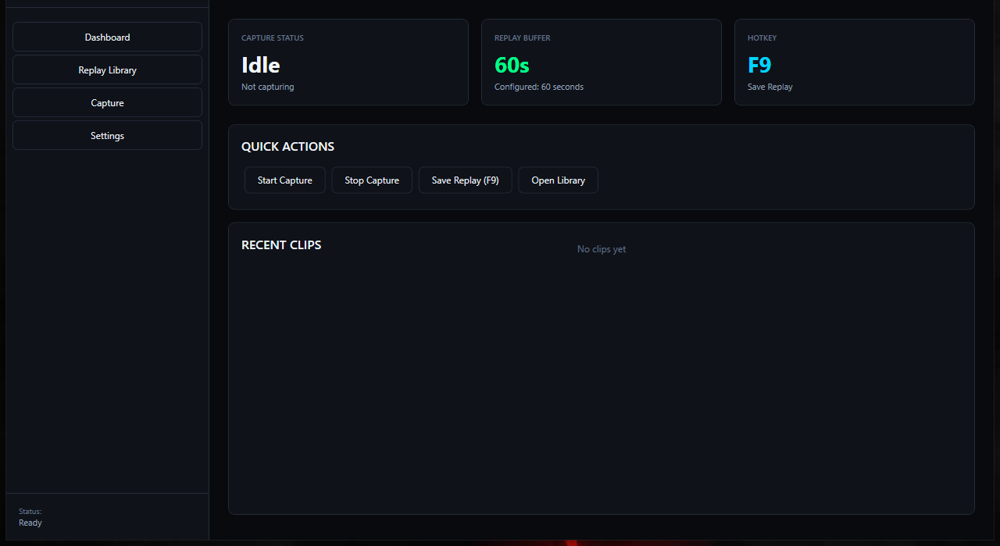
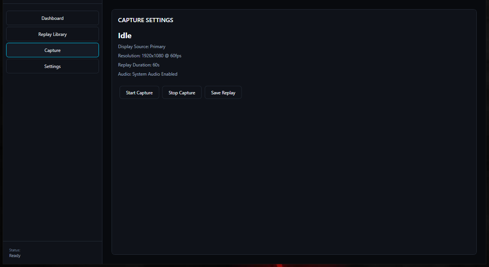
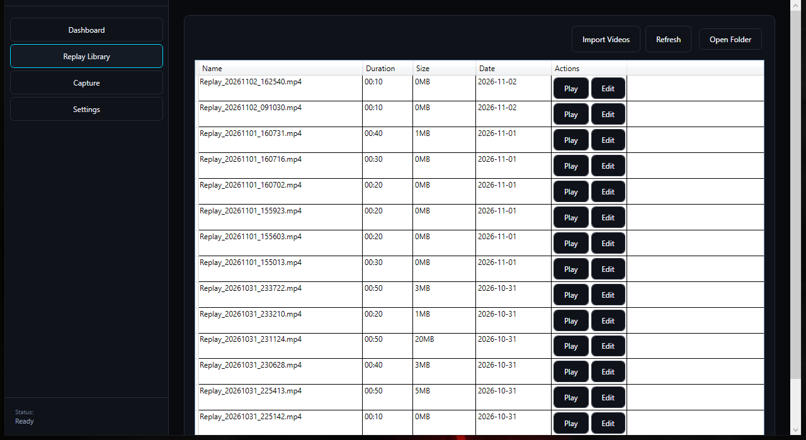

<div align="center">



# Vulcans Replay Studio

### Never lose your best moments.

Vulcans Replay Studio records your screen quietly in the background. When something great happens, press **F9** and the last moments are saved as a clip you can play, trim and keep.

**[⬇ Download the installer](https://github.com/pierrelindblom86-rgb/VulcansReplayStudio/releases/download/v1.0.1/VulcansReplayStudio-Setup-1.0.1.exe)** &nbsp;·&nbsp; **[Portable ZIP](https://github.com/pierrelindblom86-rgb/VulcansReplayStudio/releases/download/v1.0.1/VulcansReplayStudio2_1.0.1_Portable_win-x64.zip)** &nbsp;·&nbsp; **[Latest release](https://github.com/pierrelindblom86-rgb/VulcansReplayStudio/releases/latest)**

Free · Windows 64-bit · Works offline · Version 1.0.1

</div>

---

## Why Replay Studio

Good moments rarely wait for you to hit record. Replay Studio keeps a rolling replay running in the background, so the last part of a moment is always there when you need it. Save it with one key, then find it, play it and trim it in your own local library.

## Features

| | |
|---|---|
| 🎬 **Background replay recording** | Keeps a rolling replay of your screen running in the background. The replay length (60 seconds by default) is set in Settings. Capture runs at 1920×1080, 60 fps. |
| ⌨️ **Save with F9** | Press **F9** to save the current replay. You can change the hotkey in Settings. |
| 📚 **Local video library** | Every saved clip sits in a folder on your PC, browsable from **Replay Library**. |
| 📥 **Import existing videos** | Add video files you already have to your library. |
| ▶️ **Built-in player** | Watch clips inside the app, with 5-second skip buttons. |
| ✂️ **Clip editor** | Set In and Out points, reset the trim at any time, and see the trimmed length before you keep the clip. |
| 🪶 **Single Windows app** | A standard Windows installer, or a portable ZIP that needs no installation. The installer is about 60 MB. |

## How it works

1. **Start capture.** Install Replay Studio, open it, and start recording from the **Capture** page. It keeps the rolling replay running in the background.
2. **Press F9 when it counts.** Save the last replay with one key press.
3. **Watch, trim and keep.** Open **Replay Library** to play a clip, or open the **Clip Editor** to set In and Out points and trim it.

## Screenshots

<p align="center">
  
</p>

<p align="center">
  
</p>

<p align="center">
  
</p>

## Download

| File | What it is | SHA-256 |
|---|---|---|
| [`VulcansReplayStudio-Setup-1.0.1.exe`](https://github.com/pierrelindblom86-rgb/VulcansReplayStudio/releases/download/v1.0.1/VulcansReplayStudio-Setup-1.0.1.exe) | Windows installer (recommended) | `84d5191711e444ead27f84e28f1c5c0017686fbd995a5ec35edf491ac1bc3dc1` |
| [`VulcansReplayStudio2_1.0.1_Portable_win-x64.zip`](https://github.com/pierrelindblom86-rgb/VulcansReplayStudio/releases/download/v1.0.1/VulcansReplayStudio2_1.0.1_Portable_win-x64.zip) | Portable ZIP, no installation | `88398bf610e7e653d86847f1cf0a7a028bd9d0d9606f9bdf9c24294f9d70339e` |
| [`SHA256SUMS.txt`](https://github.com/pierrelindblom86-rgb/VulcansReplayStudio/releases/download/v1.0.1/SHA256SUMS.txt) | Checksums for both files | — |

Browse every version on the **[release page](https://github.com/pierrelindblom86-rgb/VulcansReplayStudio/releases/latest)**.

To check a download on Windows, run `certutil -hashfile <file> SHA256` in PowerShell and compare the output with the table above.

## System requirements

- **Windows** 64-bit (x64)
- **.NET 9 Desktop Runtime (x64).** The installer checks for it and links to the download if it is missing.
- Free disk space for your saved clips. Clips are stored in the Storage Path you choose in Settings.

## More from Vulcans

Vulcans Replay Studio and **[Vulcans Living Wallpaper](https://github.com/pierrelindblom86-rgb/VulcansLivingWP)** are two separate free Windows apps from the same developer. Each one works on its own.

---

<details>
<summary><b>Developer documentation</b> (building from source, project layout, licenses)</summary>

# Vulcans Replay Studio

A free, offline, native Windows instant-replay recorder. It keeps a rolling buffer of the screen
and saves the most recent moments on demand. Nothing is uploaded.

## Layout

- `src\VulcansReplayStudio2.sln`: the solution.
  - `VulcansReplayStudio2.App`: WPF application (`VulcansReplayStudio2.App.exe`).
  - `VulcansReplayStudio2.Core`: models and service contracts.
  - `VulcansReplayStudio2.Infrastructure`: settings, hotkeys and clip library services.
  - `VulcansReplayStudio2.MediaEngine`: capture, replay buffer and export.
  - `VulcansReplayStudio2.Core.Tests`: unit tests.
- `installer\VulcansReplayStudio2.iss`: Inno Setup script for the per-user installer.

## Requirements

- Windows 10/11 x64.
- .NET 9 SDK to build, .NET 9 Desktop Runtime (x64) to run.
- `ffmpeg.exe` and `ffprobe.exe` in `Tools\FFmpeg`. The binaries are not stored in git because
  they exceed GitHub's file size limit. They are included in the release packages.

## Build and test

```
dotnet build src\VulcansReplayStudio2.sln -c Release
dotnet test src\VulcansReplayStudio2.Core.Tests
```

## Release packages

The installer script expects a framework-dependent publish of the App in
`dist\VulcansReplayStudio2_<version>` (for example `dist\VulcansReplayStudio2_1.0.1`), with
`Tools\FFmpeg` alongside it. Compile it with Inno Setup 6:

```
dotnet publish src\VulcansReplayStudio2.App -c Release -r win-x64 --self-contained false -p:DebugType=none -o dist\VulcansReplayStudio2_1.0.1
iscc installer\VulcansReplayStudio2.iss
```

The version is set in `src\Directory.Build.props` and in `installer\VulcansReplayStudio2.iss`.

## License

MIT, see `LICENSE`. FFmpeg is distributed under its own license, see `licenses\FFmpeg-LICENSE.txt`.

</details>
